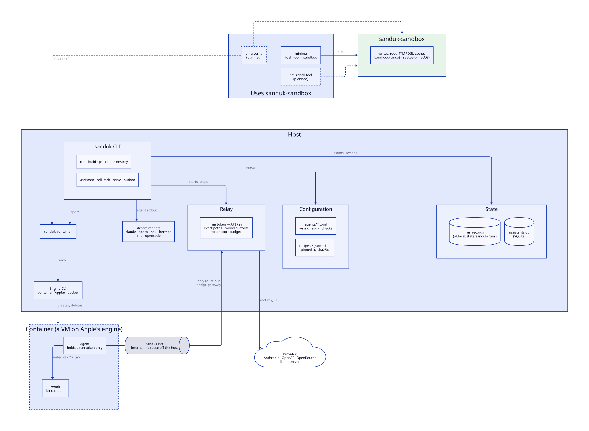

# sanduk-rs

Agent container and sandbox management in Rust: a rewrite of [sanduk](https://github.com/shakfu/sanduk), with containment and sandboxing in one place.

| Crate | What it does | Used by |
|-|-|-|
| [`sanduk-sandbox`](crates/sanduk-sandbox) | Confines a child process's writes to one directory: Landlock on Linux, Seatbelt on macOS | minima |
| [`sanduk-container`](crates/sanduk-container) | Drives a container engine's CLI: Apple's `container`, Docker | -- |
| `sanduk` | The run as a library: agents, recipes, kits, providers, the relay, the clone and its return | pma |
| [`sanduk-cli`](crates/sanduk-cli) | The `sanduk` binary, and assistants | -- |



The two tiers cover different threats:

- `sanduk-sandbox` stops a model that errs from writing outside the project. Reads and the network stay open, so it does not contain an adversarial prompt.

- `sanduk-container`, in `sealed` mode, is the boundary for untrusted prompts: no route off the host, and no API key in the box.

  The host itself stays reachable at the network's gateway: a host service bound to every address (`0.0.0.0`, `::`) answers the container. A sealed run warns on Linux when one listens. Bind such services to `127.0.0.1`.

See [docs/dev/rewrite.md](docs/dev/rewrite.md) for the plan.

## sanduk-sandbox

```rust
let policy = sanduk_sandbox::Policy::new(".")?.writable("/opt/store")?;
policy.preflight()?;
let status = policy.command("bash")?.args(["-c", "cargo build"]).status()?;
```

Writes are allowed under the root, `$TMPDIR`, `/dev/null`, the toolchain caches and each `writable` directory. The toolchain caches are cargo's `registry/` and `git/`, go's `pkg/mod`, `~/.npm` and `$XDG_CACHE_HOME`; `bin/` directories are excluded. On macOS the policy also denies preference writes, `open`, and signals to processes outside the sandbox.

Linux needs kernel 6.2 (Landlock ABI 3). Below that floor, and on a kernel built without Landlock, `command` and `preflight` fail rather than run unconfined. Apple's `container` guest kernel (6.18.15) is one: `CONFIG_SECURITY_LANDLOCK` is not set.

`confine_path` is the userspace check for writes a program makes in its own process. It refuses paths outside the root and paths with a `.git` or `.env*` component.

## sanduk-container

```rust
use sanduk_container::{ContainerSpec, Engine};

let engine = Engine::get(None)?; // Apple's `container` on macOS if installed, else Docker
engine.require_run()?;
let spec = ContainerSpec { detach: true, ..ContainerSpec::new("sanduk-x", "alpine:3.20") };
let argv = engine.run_argv(&spec); // run it however the caller needs its stdio
engine.destroy(&spec.name)?;
```

Every container gets `--cap-drop ALL --init`; on Docker also `--security-opt no-new-privileges --pids-limit 1024`. `ensure_network` creates an internal network, and refuses to reuse a routable one for a sealed run where the engine reports the mode. `hold_network_up` keeps Apple's host bridge alive so the relay can bind the gateway. Nothing prints: outcomes are returned, and `destroy` fails when the delete does.

## sanduk

The caller owns the agent's process. `plan` checks and acquires nothing; `start` acquires the image, network, relay and clone; the caller runs `command()` its own way; `finish` runs the check and the clone's return, then tears down.

```rust
use sanduk::run::{Mode, Options};

let sanduk = sanduk::Sanduk::new(sanduk::util::Dirs::default()).observer(observer);
let mut live = sanduk
    .plan(Options { task: Some(task), workdir, mode: Mode::KeySafe, ..Options::default() })?
    .start()?;
let status = live.command().status()?;
let outcome = live.finish(status); // verify, branch or kept clone, relay stats, report
```

Notes go to the `Observer`, image build output included; nothing prints. Errors carry an `ErrorKind` (`Refused`, `Setup`, `Return`, `Interrupted`) and name no CLI flag: `Error::option` names the `Options` field an error is about. With the `test-util` feature, `sanduk_container::testing::Fake` is a Docker engine with no daemon, for `Sanduk::engine`. See [docs/dev/refactor-as-library.md](docs/dev/refactor-as-library.md).

## The relay

`sanduk::relay::Relay::start(config, gateway, 0)` serves on a background thread and returns the port. The container presents a per-run token; the relay checks it, admits only the provider's exact paths, applies the model allowlist and token cap, writes the real key upstream, and streams the response back while reading its usage. With a `budget`, calls take turns from the check to the charge, so concurrent calls cannot spend past it.

Request bodies are read whole, up to 64 MiB (`max_body`), because the policy needs the JSON; a larger one is refused with 413. The upstream exchange runs in its own task, so a client that hangs up cannot stop the call being charged.

## The CLI

`cargo install sanduk-cli` installs `sanduk`. Every Python sanduk command, with the same flags and output: `run`, `build`, `shell`, `ps`, `stop`, `clean`, `destroy`, `system`, `list`, and the assistant commands `assistant`, `tell`, `tick`, `serve`, `outbox`, `approve`, `reject` and `runs`. `sanduk --help` lists them. Images and the assistants database are shared with Python sanduk: either binary uses what the other built or wrote.

`run --clone` gives the agent a clone of the `-w` repository and fetches its commits back as branch `sanduk/<run>`, so the agent never writes the repository's `.git`.

Agents are TOML files: see [docs/agents.md](docs/agents.md). Kits add tools to an agent's image; `build`, `rust`, `go` and `uv` ship for `run --verify`, and stack: `--kit rust --kit uv`. `sanduk list kits` shows them.

## Development

```text
make test    # cargo test
make lint    # fmt --check, clippy -D warnings
make live    # needs the network: a real container engine, and one relayed call over TLS
make diagrams  # docs/media/*.d2 to SVG, with d2 --layout=tala
```

The Linux backend is tested only on a Linux host with Landlock. CI runs both platforms.
